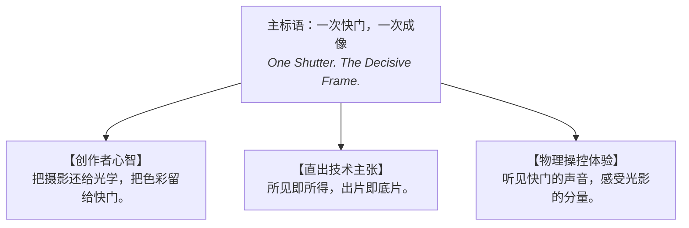
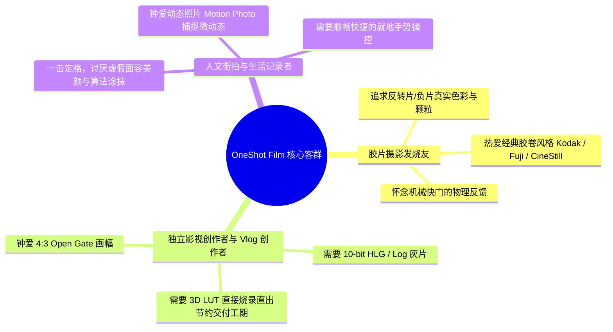

# OneShot Film — 品牌白皮书与设计资产手册

> **“一次快门，一次成像。”**  
> *One Shutter, One Instant. Pure Chemistry, Modern Optics.*

---

## 一、 品牌总览 (Brand Overview)

| 维度 | 品牌规范定义 | 备注 |
| :--- | :--- | :--- |
| **产品中文全称** | **OneShot Film 专业胶片影像** | 兼顾专业性与胶片复古情怀 |
| **产品英文名称** | **OneShot Film** (推荐正式字形) | 统一规范大小写，避免混淆 |
| **视觉标准字** | `ONESHOT FILM` / `OneShot Film` | 工业极简衬线/无衬线组合 |
| **核心中文标语 (Slogan)** | **一次快门，一次成像** | 核心品牌主张，致敬决断瞬间 |
| **核心英文标语** | **One Shutter. The Decisive Frame.** | 对应英文国际化传播 |
| **品牌副标语 (Sub-slogan)**| **把摄影还给光学，把色彩留给快门。** | 反对过度计算摄影的品牌宣言 |
| **品类定位** | 物理级操控 · 实时 3D LUT 胶卷直出 · 专业安卓电影相机 | 兼备严肃工具与复古影像双重属性 |

---

## 二、 品牌哲学与宣言 (Brand Philosophy & Manifesto)

### 2.1 诞生背景：后计算摄影时代的审美反思
智能手机摄影在过去十年间被“多帧堆栈”、“算法提亮”、“暴力锐化”与“HDR 涂抹”所主导。技术消灭了噪点与欠曝，却也消灭了光影的呼吸感、暗部的神秘感以及物理镜头的微瑕美感。所有人的照片都变得扁平、油腻、千篇一律。

**OneShot Film** 诞生于对这种“虚假完美”的反叛。

### 2.2 核心哲学：一次快门，一次成像
在胶片时代，按下快门意味着不可逆的光化学反应。摄影师谨慎、专注，对光线怀有敬畏；胶卷将这一刻的色温、颗粒与反差一次性固化。

- **一次快门**：代表决断、仪式感与纯粹的物理交互。拒绝无节制的连拍废片堆叠，重拾每一次击发快门的期待。
- **一次成像**：代表真实的直出哲学。依靠硬件级 3D LUT（柯达、富士、好莱坞胶片曲线）直接烧录，所见即所得。拍下的那一瞬间，化学反应已经完成，告别漫长繁琐的后期调色软件。

```
              [ 传统计算摄影 ]                 [ OneShot Film ]
               狂按无序连拍                      一击即中 专注取景
                    ↓                                  ↓
             黑盒算法堆栈涂抹                  硬件级光学直读与色彩烧录
                    ↓                                  ↓
             塑料感/过度锐化                   有机颗粒/呼吸感/胶卷反差
                    ↓                                  ↓
             漫长且疲惫的后期                  一次快门，一次成像 (即刻分享)
```

---

## 三、 品牌命名体系与语义规范 (Naming System)

### 3.1 命名解析与勘误建议
- **官方推荐字形**：`OneShot Film`
- **关于拼写注意（特别提醒）**：
  - 建议纠正草案中的笔误 `flim` $\to$ **`film`**。
  - **原因**：在摄影与电影行业中，`Film`（胶卷/底片/电影）具有极高的大众认知度与专业背书；若使用 `flim`，极易被全球用户、App Store 与 Google Play 算法误判为拼写错误（Typo），影响品牌搜索权重与严肃感。
- **排版规范**：
  - 正文排版：统一写作 **OneShot Film**（O 与 S、F 大写，中间留空格或以品牌词紧凑呈现）。
  - 图标与工业铭牌：推荐全大写 `ONESHOT FILM`。
  - 简写/内部代号：`OS Film` 或 `OneShot`。

### 3.2 标语矩阵 (Slogan Matrix)



- **品牌主张（Brand Claim）**：
  - 中文：*一次快门，一次成像。*
  - 英文：*One Shutter, One Instant.* / *One Press, Pure Film.*
- **功能诉求（Functional Slogan）**：
  - *“3D LUT 硬件级烧录，告别调色，直出胶卷质感。”*
  - *“4:3 Open Gate 全画幅读出，捕捉未被裁剪的真实视界。”*
- **情感触达（Emotional Slogan）**：
  - *“每一次按压，都是对时间的郑重封存。”*

---

## 四、 品牌定位与用户画像 (Brand Positioning & Personas)

### 4.1 目标市场坐标系
OneShot Film 处于 **“专业级操控工具”** 与 **“胶片美学直出工具”** 的交叉黄金象限：
- **区别于普通滤镜相机（如 Dazz / NOMO）**：OneShot Film 具备底层硬件级曝光控制、Camera2/HAL 探针、RAW/Log 曲线、4:3 Open Gate 与物理级 HUD，具备严肃创作能力，绝非简单贴图滤镜。
- **区别于传统专业工业相机（如 MotionCam / Blackmagic Cam）**：OneShot Film 摒弃了冷冰冰的技术参数堆砌，注入了浓郁的胶片色彩科学、三快门趣味交互与极佳的日常扫街即时成像体验。

### 4.2 核心用户画像



---

## 五、 产品特性与品牌价值映射 (Feature-to-Brand Matrix)

OneShot Film 的每一项底层工程特性，均服务于品牌哲学的落地：

| 核心硬件/工程功能 | 对应的品牌体验 | 解决的用户痛点 |
| :--- | :--- | :--- |
| **3D LUT 实时烧录 (Burn-in)** | **“一次成像”的直出底气** | 传统相机拍完还要导入 Lightroom 套预设，繁琐疲劳；此处按下即成片。 |
| **三快门独立物理集群** | **决断时刻的多维选择** | 静态抓拍、动态照片 (Motion Photo)、视频录像独立按钮，无需滑动切换模式错失良机。 |
| **两段式触觉震动反馈** | **机械相机的快门仪式感** | 模拟实体快门手感，确认对焦与击发瞬间，建立人机之间的触觉连结。 |
| **4:3 Open Gate 传感器全读出** | **未被阉割的光学视界** | 告别手机传统录像的上下裁剪，释放传感器完整感光面积与镜头像圈。 |
| **HUD 就地滑动微调 + ABGM 调色盘** | **专业摄影师的敏捷操控** | 参数随手横滑即调，长按即刻回归 Auto，像操作旁轴机械转盘一样直观。 |
| **防过热调暗屏幕与性能保护** | **可靠持久的创作伙伴** | 长时间创作时不降频、不丢帧、稳定记录每一个重要历史瞬间。 |

---

## 六、 视觉与感官设计规范 (Sensory & Visual Identity)

### 6.1 品牌色彩规范 (Palette)
色彩灵感汲取自暗房红光、经典胶卷金属筒与现代光学钛金属：

```
[ Obsidian Black ]   [ Amber Grain ]      [ Darkroom Red ]     [ Titanium Gray ]
      #121212             #F5A623              #E03E3E              #8E8E93
   底片黑 / 界面底色    柯达琥珀黄 / 强调色   暗房红 / 录制与警示   工业钛灰 / 辅助刻度
```

- **曜石黑 (Obsidian Black - `#121212`)**：沉静、专业、纯粹取景环境，降低杂光干扰。
- **底片琥珀黄 (Amber Grain - `#F5A623`)**：致敬柯达与暖调卤化银乳剂，用于核心快门、高亮指示。
- **暗房红 (Darkroom Red - `#E03E3E`)**：致敬传统冲洗暗房安全灯与电影机 Tally 录制红灯。
- **钛金冷灰 (Titanium Gray - `#8E8E93`)**：专业刻度表、标尺与微调 HUD 颜色。

### 6.2 声音与触感设计 (Haptics & Audio)
- **触感系统 (Physicality)**：
  - 轻触对焦：轻微段落感（`CLOCK_TICK` 级微触觉）。
  - 快门击发：果断、干脆的深层电磁马达振动，模拟机械快门帘幕开合。
  - 滑轮微调：转动刻度时的棘轮阻尼感（Click-click 细腻步进反馈）。
- **视听体验**：
  - 动态照片（Motion Photo）捕获声音保留现场环境的自然质感。

---

## 七、 品牌传播故事脚本与样例文案

### 7.1 应用商店 (App Store / Google Play) 简介示例

> **OneShot Film — 一次快门，一次成像**
>
> 告别千篇一律的计算摄影抹皮与暴力锐化。  
> OneShot Film 专为追求纯粹影像质感的创作者而生。
>
> 我们将专业级摄影机的物理操控，与经典胶卷的光化学灵魂注入你的手机。  
> 搭载底层硬件级 3D LUT 引擎，支持实时取景与直接烧录，胶片色调直出相册。  
> 独创三快门系统、Open Gate 全画幅读出、10-bit HLG 电影录制以及拟真机械触觉反馈。
>
> 这里没有繁琐的后期调色，没有被算法涂抹的光影。  
> **按下快门，剩下的交给光学。**

### 7.2 社交平台首发宣言 (Launch Post)

```
【我们做了一款反对“过度计算摄影”的相机】

现在的手机相机越来越像一台电脑，而不是一个镜头。
它替你磨平了噪点，替你把黑夜点成白昼，也替你抹去了原本应该存在的阴影。

我们想重拾摄影最初的兴奋感：
是在取景器里屏住呼吸的凝视，
是手指压下快门时干脆利落的机械震颤，
是光线与色彩在瞬间完成交融的确定感。

OneShot Film。
一次快门，一次成像。
你所见的，即是胶片所留下的。
```

---

## 八、 品牌资产版本记录

- **v1.0.0 (2026-10-14)**：初始确立品牌命名体系（`OneShot Film`）、核心标语（`一次快门，一次成像`）、品牌宣言与视觉定位规范。
