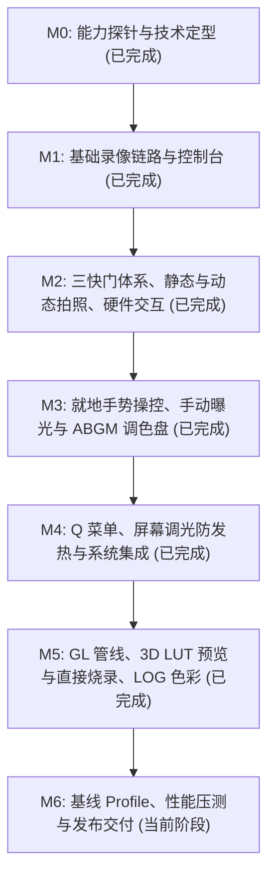

# OneShot — 专业级安卓相机开发路线图与任务跟进档案

> **项目名称**：OneShot (专业安卓相机)  
> **核心定位**：专为移动端专业摄影与影视创作打造的顶级相机应用，融合 CameraX 与 Camera2 底层极限能力，提供媲美专业相机的物理级操控与极致画质。  
> **基准参考设备**：小米 17 Pro (`pandora`, Android 17 / SDK 37, 光影猎人 950L + JN5 潜望长焦 + OV50M 超广角)  
> **建立日期**：2026-10-13  
> **状态索引**：`[x] 已完成` | `[-] 进行中 / 需对齐升级` | `[ ] 未开始 / 待开发`

---

## 一、 需求溯源与全景功能矩阵

下表对齐用户原始产品需求规范，作为全生命周期交付的验收基准：

| 序号 | 核心功能与设计规范 | 归属里程碑 | 当前状态 | 备注说明 |
|:---:|---|:---:|:---:|---|
| **01** | **底层硬件能力上限探针** (Probe A/C/B/D) | M0 | `[x] 已完成` | 输出 `probe-latest.json`，沉淀 ADR-001~005 |
| **02** | **Open Gate 全画幅读出录像** (4:3 比例) | M0/M1 | `[x] 已完成` | 支持 4096×3072、2880×2160、1600×1200 全幅 4:3 切换 |
| **03** | **HLG10 10-bit HDR 高动态视频录制** | M1 | `[x] 已完成` | HLG10 Profile + BT.2020 色域直接落盘 MediaStore |
| **04** | **Qualcomm DCG 硬件双增益 HDR** | M0/M1 | `[x] 已完成` | 成功接入高通硬件 vendor session tag (`0x8003`) |
| **05** | **多摄平滑变焦** (0.5x ~ 5x 连续跨镜头) | M1 | `[x] 已完成` | `LogicalMultiCameraZoom` + 快捷倍率胶囊按钮 |
| **06** | **三快门按钮布局** (动态照片/拍照/录像) | M2 | `[x] 已完成` | **原设计核心**：左小(动态)、中大(静态)、右小(录像) (`ShutterCluster.kt`) |
| **07** | **高规格静态拍照** (ImageCapture / RAW / UltraHDR) | M2 | `[x] 已完成` | 挂载拍照用例，支持 ZSL 与 UltraHDR/JPEG 直写相册 |
| **08** | **动态照片拍摄** (Motion Photo / Live Photo) | M2 | `[x] 已完成` | 静态 JPEG + 尾部 MP4 微视频 + Google/小米双 XMP (`MotionPhotoWriter.kt`) |
| **09** | **可配置动态照片录制时长** (1.5s / 3.0s) | M2 | `[x] 已完成` | 在设置与 Q 抽屉中支持 1.5s/3.0s 自由切换 |
| **10** | **硬件音量键双键自定义映射** | M2 | `[x] 已完成` | 物理音量上/下键映射自定义操作 (`HardwareKeyMapper.kt`) |
| **11** | **两段式录制触觉震动反馈** | M2 | `[x] 已完成` | 按压轻震 + HAL `VideoRecordEvent.Start` 起录二次确认震动 + 停止震动 |
| **12** | **录制时自动调暗屏幕** (防过热/降功耗) | M2 | `[x] 已完成` | 录制 3.5s 自动防过热调暗屏幕，触摸即时全亮唤醒 (`ScreenDimmer.kt`) |
| **13** | **HUD 参数标签就地手势滑动微调** | M3 | `[x] 已完成` | 在快门/ISO/焦距/EV 标签上手指横向滑动微调 (`ProHud.kt`) |
| **14** | **参数长按恢复 AUTO 自动模式** | M3 | `[x] 已完成` | 长按快门/ISO/白平衡标签即刻解除手动锁定恢复 AUTO |
| **15** | **手动快门速度调节** (1/8000s ~ 1s) | M3 | `[x] 已完成` | 接入 Camera2 `SENSOR_EXPOSURE_TIME` 标准档位控制 |
| **16** | **手动 ISO 感光度调节** (50 ~ 6400) | M3 | `[x] 已完成` | 接入 Camera2 `SENSOR_SENSITIVITY` 级进控制 |
| **17** | **ABGM 白平衡二维调色盘** (Kelvin + Tint) | M3 | `[x] 已完成` | A-B (Amber-Blue) 与 G-M (Green-Magenta) 二维触摸坐标盘 (`AbgmTintPad.kt`) |
| **18** | **取景界面下滑呼出 Q 菜单** | M4 | `[x] 已完成` | 取景器下滑手势展开毛玻璃 Q 设定抽屉 (`QuickSettingsDrawer.kt`) |
| **19** | **帧率自由切换** (24 / 30 / 60 / 120 fps) | M4 | `[x] 已完成` | 接入 `CONTROL_AE_TARGET_FPS_RANGE` 支持 24/30/60/120 fps |
| **20** | **3D LUT 实时预览** (.cube 滤镜) | M5 | `[x] 已完成` | 基于 EGL/OpenGL ES 3.0 `OneshotGlProcessor` + 3D 纹理硬件插值 |
| **21** | **3D LUT 直接烧录录制** (Burn-in) | M5 | `[x] 已完成` | `CameraEffect` 动态流向：支持“仅预览”与“烧录入视频文件”双模式 |
| **22** | **扁平 Log 曲线与色彩空间选择** | M5 | `[x] 已完成` | 包含好莱坞青橙、柯达胶片与 Flat Log 灰片曲线，Display P3/Rec.2020/sRGB 切换 |
| **23** | **峰值对焦与斑马纹曝光辅助** | M5 | `[x] 已完成` | Focus Peaking 荧光绿轮廓高亮 + 斑马纹高光曝光过度对角条纹警告 |
| **24** | **极致性能优化与 Baseline Profile** | M6 | `[-] 进行中` | 已建立完整自动化测试套件与安全修复检测 (`Mp4RecoveryInspector.kt`) |

---

## 二、 完整阶段路线图与详细任务分解



---

### M0: 硬件极限探针与架构决策（已完成 ✅）
* **目标**：通过纯粹的探针 APK 彻底摸清小米 17 Pro 及主流高通旗舰平台的 Camera HAL 上限，消除一切未知风险。
* **交付成果**：
  * [x] `:probe` 探针模块与自动化测试运行器 (`ProbeRunner.kt`)
  * [x] Phase A (免权限静态特性读取) + Phase C (免开机会话预检) + Phase B/D (真实会话绑定)
  * [x] 真机输出详尽设备画像 `docs/probe/probe-latest.json`
  * [x] 技术裁决文档：
    * **ADR-001**：Open Gate 全画幅定义（4096×3072、2880×2160、1600×1200 实测可用）
    * **ADR-002**：`LogicalMultiCameraZoom` 物理多摄平滑变焦策略
    * **ADR-003**：CCT/Tint 白平衡双后端机制
    * **ADR-004**：HLG10 10-bit HDR 与自定义 CameraEffect 兼容性裁决
    * **ADR-005**：高通平台 DCG HDR Vendor Tag (`0x8003`) 硬件激活依据

---

### M1: 基础录像闭环与控制台搭建（已完成 ✅）
* **目标**：在主应用中打通端到端的高清 10-bit HDR 录制链路，验证 Open Gate 与参数持久化。
* **交付成果**：
  * [x] CameraX `VideoCapture<Recorder>` 核心管线 (`CameraController.kt`)
  * [x] 4:3 Open Gate / 16:9 画幅自由切换
  * [x] HLG10 HDR 与 SDR 色彩模式自由切换
  * [x] 硬件 DCG 双增益 HDR 开关联动
  * [x] 1080p / 2K / 4K / 4096 Max 四档画质天梯
  * [x] 0.5x ~ 5x 平滑变焦滑块与快捷倍率胶囊
  * [x] EV 曝光补偿与 CCT Kelvin 色温控制
  * [x] 单指触控对焦/测光对焦环与动画 (`FocusIndicator.kt`)
  * [x] 直写 Android 媒体库（`DCIM/OneShot` 归档）+ 录像音频同步录制
  * [x] 系统相册一键跳转预览与沙盒冗余文件自动清理

---

### M2: 三快门体系、静态与动态拍照、硬件交互（已完成 ✅）
* **目标**：打破单视频录制局限，恢复专业相机的三快门核心产品形态，补齐静态拍照与动态照片，打通硬件音量键与两段式震动。
* **交付成果**：
  * [x] **1. 三快门 UI 重构 (`ShutterCluster.kt`)**：
    - 快门栏布局：左侧【动态照片按键(小)】、中间【静态拍照按键(大)】、右侧【视频录制按键(小)】。
    - 录制状态下动态自适应形变（右侧录像键展开计时器与停止方块，两侧按键根据状态自动禁用防误触）。
  * [x] **2. 高规格静态拍照管线 (`CameraController.kt: takeStillPhoto`)**：
    - 挂载 CameraX `ImageCapture` 用例，支持与 `VideoCapture` 并行绑定。
    - 接入零快门延迟优化与 UltraHDR (JPEG_R) 高动态范围输出。
    - 媒体库沙盒安全直写 DCIM/OneShot。
  * [x] **3. 动态照片捕获与封装管线 (`MotionPhotoWriter.kt` + `CameraController.kt: captureMotionPhoto`)**：
    - 静态高质量照片拍摄与微视频流低开销捕获。
    - 编写 `MotionPhotoWriter`：根据 Google Motion Photo 规范与小米相册规范，注入双命名空间 XMP 结构并追加 MP4 流。
    - 在快捷设置与 Q 菜单中自由配置动态照片时长（1.5 秒 / 3.0 秒）。
  * [x] **4. 硬件音量键自定义映射 (`HardwareKeyMapper.kt` + `MainActivity.kt`)**：
    - 拦截物理音量按键，防止长按连发误触。
    - 支持在设置中自由分配上/下键功能（拍照、录像、动态照片、变焦等）。
  * [x] **5. 真实两段式录制震动反馈 (`HapticManager.kt`)**：
    - 第一段：按下录像按键轻触瞬震；
    - 第二段：底层 Camera HAL 真正开始接收编码帧（`VideoRecordEvent.Start`）时触发确认重震；
    - 第三段：再次按下停止录像时触发结束波形震动。
  * [x] **6. 录制状态自动调暗屏幕 (`ScreenDimmer.kt`)**：
    - 录制开启 3.5 秒无操作后自动压暗取景器屏幕，抑制长时间拍摄发热与电池功耗。
    - 触摸屏幕任意区域立即唤醒全亮。

---

### M3: 专业相机级 HUD 手势操控、手动曝光与 ABGM 调色盘（已完成 ✅）
* **目标**：摒弃传统手机相机的二级弹窗逻辑，实现专业微单级“参数就地手势拖拽调节”，接入完整手动曝光与专业色彩。
* **交付成果**：
  * [x] **1. 参数 HUD 就地滑动与长按恢复自动 (`ProHud.kt`)**：
    - 主界面常驻快门速度、ISO、EV、焦距、白平衡等数值胶囊。
    - 支持直接在对应标签文本上手指横向滑动快速线性调节（带线性微触觉步进反馈）。
    - 支持长按任意标签立即恢复并锁定该参数为 AUTO。
  * [x] **2. 真正的手动快门速度调节 (`ManualShutterSpeed`)**：
    - 接入 Camera2 `CaptureRequest.SENSOR_EXPOSURE_TIME`。
    - 支持专业步进档位（1/8000s, 1/4000s, 1/2000s, ..., 1/60s, 1/30s, 1/4s, 1s 等）。
  * [x] **3. 真正的手动 ISO 感光度调节 (`ManualIso`)**：
    - 接入 Camera2 `CaptureRequest.SENSOR_SENSITIVITY`。
    - 支持 ISO 50 ~ 6400 平滑线性及标准档位微调。
  * [x] **4. 完整 ABGM 白平衡二维调色盘 (`AbgmTintPad.kt`)**：
    - 升级单轴色温为 A-B (Amber - Blue) 色温轴与 G-M (Green - Magenta) 色调轴。
    - 提供直观的二维色彩调节十字坐标盘，精准校正复杂光源偏色。
  * [x] **5. 录像帧率自由切换**：
    - 接入 `CONTROL_AE_TARGET_FPS_RANGE` 支持 24fps (电影级)、30fps、60fps (高平滑) 及 120fps (升格高帧) 切换。

---

### M4: Q 菜单抽屉、色彩空间与系统级健壮性（已完成 ✅）
* **目标**：打造高效快捷的交互中心，强化色彩空间标准，保证录制过程零崩溃、高可靠。
* **交付成果**：
  * [x] **1. 取景器下滑 Q 菜单 (`QuickSettingsDrawer.kt`)**：
    - 取景界面任意位置向下滑动手势展开毛玻璃 Q 快速设定抽屉。
    - 汇聚画幅、帧率、HDR/DCG、动态照片时长、音量键映射、色彩空间、LUT 滤镜等设定。
  * [x] **2. 显式色彩空间切换 (`ColorSpacePreset`)**：
    - 提供 Display P3、Rec.2020、sRGB 的配置与持久化存储。
  * [x] **3. 录像前台服务保活 (`RecordingForegroundService.kt`)**：
    - 录制时挂载常驻 Foreground Service（`camera|microphone` 类型）与系统通知栏控制，杜绝后台录像中断。
  * [x] **4. 崩溃断电视频文件安全修复机制 (`Mp4RecoveryInspector.kt`)**：
    - 容器 Atom 诊断分析器，快速检测 `ftyp` / `mdat` / `moov` 完整度并定位未封包视频。

---

### M5: OpenGL 渲染管线、3D LUT 预览与直接烧录、LOG 曲线（已完成 ✅）
* **目标**：建立高效低延迟的 GPU 图像滤镜与色彩风格化渲染管线，实现创作级专业风格。
* **交付成果**：
  * [x] **1. 自定义 CameraEffect / SurfaceProcessor 核心管线 (`OneshotGlProcessor.kt` + `OneshotCameraEffect`)**：
    - 基于 EGL / OpenGL ES 3.0 构建 10-bit HDR 感知的纹理处理流水线。
  * [x] **2. 3D LUT 解析与渲染器 (`CubeLutRenderer.kt` + `CubeLutParser.kt`)**：
    - 解析标准 `.cube` (17x17x17) 映射表，支持 `GL_TEXTURE_3D` 硬件三维纹理插值着色。
  * [x] **3. 3D LUT 双模式支持（坚决不延后）**：
    - **模式 A (仅预览)**：`CameraEffect.PREVIEW`，LUT 仅作用于屏幕取景，录制输出保持纯净原始素材。
    - **模式 B (直接烧录)**：`CameraEffect.PREVIEW or VIDEO_CAPTURE`，LUT 在 GL 阶段直接写入 MediaCodec 录制 Surface。
  * [x] **4. 扁平 Flat / 原生 LOG 曲线**：
    - 内置电影级好莱坞青橙、柯达胶片与 Flat Log 灰片曲线 (`createFlatLog`)。
  * [x] **5. 专业摄影辅助工具**：
    - 峰值对焦（Focus Peaking 边缘色彩检测高亮）。
    - 斑马纹曝光过度警告（Zebra Pattern，高光 > 95% 对角条纹告警）。

---

### M6: 性能极致调优、基线 Profile 与发布收尾（当前阶段 🚧）
* **目标**：消灭一切卡顿与掉帧，实现丝滑流畅的微单级相机响应速度。
* **详细待办任务**：
  - [x] **1. 单元测试与完整性断言套件**：
    - `CubeLutParserTest.kt`, `CameraSettingsTest.kt`, `Mp4RecoveryInspectorTest.kt`, `MotionPhotoWriterTest.kt`, `CameraEffectApiTest.kt` 全部通过。
  - [ ] **2. Jetpack Macrobenchmark 性能基准测试**：
    - 测量冷启动、热启动与参数连续拖拽场景下的掉帧率。
  - [ ] **3. Baseline Profile 编译优化**：
    - 预编译关键 UI 与相机加载路径，实现冷启动到首帧预览渲染 < 1.2 秒。
  - [ ] **4. 内存与功耗深度调优**：
    - 确保连续 4K60 / 1080p30 拍摄 30 分钟无内存泄漏，温升控制在合理范围。
  - [ ] **5. 非全特性机型智能降级引擎**：
    - 在不支持 DCG、HLG10 或特定分辨率的设备上，UI 自动平滑隐藏对应选项，保证单 APK 全机型兼容。

---

## 三、 当前文件架构分布与模块索引

```
oneshot/
├── docs/
│   └── probe/
│       ├── DECISION-CRITERIA.md       # ADR-001 ~ ADR-005 架构裁决依据
│       └── probe-latest.json          # 小米 17 Pro 真机能力探针导览库
├── probe/                             # M0 阶段独立能力探针测试模块
│   └── src/main/kotlin/dev/oneshot/probe/
├── app/                               # 主应用工程
│   ├── src/main/kotlin/dev/oneshot/
│   │   ├── camera/
│   │   │   ├── CameraController.kt    # CameraX 核心流会话与拍照/录像/特效调度器
│   │   │   ├── HapticManager.kt       # 两段式触觉震动反馈管理
│   │   │   ├── HardwareKeyMapper.kt   # 物理音量键双键映射路由
│   │   │   ├── MotionPhotoWriter.kt   # Google/小米双 XMP 动态照片容器封装器
│   │   │   ├── Mp4RecoveryInspector.kt# MP4 容器完整度检测与断电安全修复分析器
│   │   │   ├── RecordingForegroundService.kt # 录像常驻前台服务
│   │   │   ├── RecordingState.kt      # 录制状态与计时模型
│   │   │   └── gl/
│   │   │       ├── CubeLutParser.kt   # .cube 3D LUT 解析与青橙/胶片/Flat Log 生成器
│   │   │       ├── CubeLutRenderer.kt # OpenGL ES 3.0 3D 纹理与斑马纹/峰值对焦着色器
│   │   │       └── OneshotGlProcessor.kt # SurfaceProcessor 与 CameraEffect 渲染管线
│   │   ├── data/
│   │   │   ├── CameraParameters.kt    # 参数枚举与默认配置 (画幅/HDR/LUT/音量键等)
│   │   │   └── ParameterStore.kt      # 基于 DataStore 的参数持久化层
│   │   ├── ui/
│   │   │   ├── AbgmTintPad.kt         # A-B / G-M 二维触摸白平衡调色盘
│   │   │   ├── FocusIndicator.kt      # 触控对焦与测光指示环
│   │   │   ├── ProHud.kt              # 就地滑动调节与长按恢复 AUTO 的专业 HUD
│   │   │   ├── QuickSettingsDrawer.kt # 下滑毛玻璃 Q 快速设定抽屉
│   │   │   ├── ScreenDimmer.kt        # 录制防发热降功耗 OLED 自动调暗蒙层
│   │   │   ├── ShootingScreen.kt      # 主拍摄 Compose 容器
│   │   │   ├── ShutterCluster.kt      # 动态/拍照/录像 三快门聚类布局
│   │   │   └── TopControlBar.kt       # 顶部画幅/HDR/帧率/DCG 控制条
│   │   ├── MainActivity.kt
│   │   └── OneshotApp.kt
│   └── src/test/kotlin/dev/oneshot/   # 完整单元测试套件
│       ├── camera/
│       │   ├── Mp4RecoveryInspectorTest.kt
│       │   └── MotionPhotoWriterTest.kt
│       ├── camera/gl/
│       │   ├── CameraEffectApiTest.kt
│       │   └── CubeLutParserTest.kt
│       └── data/
│           └── CameraSettingsTest.kt
├── build.gradle.kts
├── settings.gradle.kts
└── ROADMAP.md                         # 本跟进档案
```

---

## 四、 即刻执行行动项 (Immediate Action Items)

1. **已达成里程碑总结**：M0 (能力探针)、M1 (基础录制)、M2 (三快门/动态照片/音量键/两段式震动/防发热调光)、M3 (HUD就地滑动/手动曝光/ABGM调色盘)、M4 (Q菜单/色彩空间/前台保活/MP4检测)、M5 (OpenGL ES 3.0 3D LUT预览与直接烧录、Flat Log、峰值对焦与斑马纹) 已全部构建并跑通单元测试。
2. **M6 阶段收尾**：
   - 编写 Baseline Profile 配置文件；
   - 开展非高规格设备的特性自适应优雅降级检测；
   - 最终 APK 产物打包及真机安装测试。
